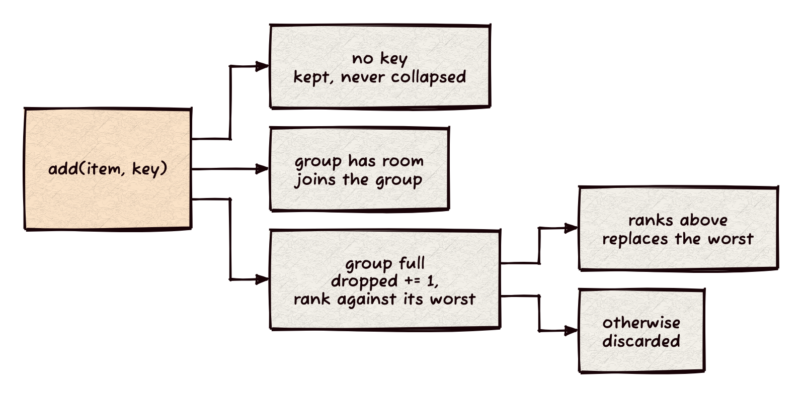

> Status: CURRENT (2026-10-30) `include/prospect/collapse.hh` at prospect main `b348da5`; design `docs/design/phase-4.md` "Collapse (D9; R10)". Source chapter for the Architecture and Design book, section 8.7. Xapian sources were not read for this note.

# Collapse: the best `collapse_max` per key, exactly

Collapse keeps at most `collapse_max` documents for each collapse key, the best ranked, and counts the rest. `prospect::collapse::collapser` (`include/prospect/collapse.hh:115`) does it with one table of groups. For any `collapse_max`, the kept set is the `collapse_max` best of everything offered for the key, never an approximation of it.

## How it works

`add(item, key)` (`collapse.hh:122`) takes each match once:

- **No key.** A document without a value never collapses; it goes to `loose_` and stays (`collapse.hh:124`).
- **Room.** While the key's group holds fewer than `collapse_max` documents, the document joins it (`collapse.hh:126`).
- **Full.** The group's `dropped` count goes up by one (`collapse.hh:127`). The group's worst-ranked document is found by scanning its at most `collapse_max` entries (`std::max_element` under the ranking, `collapse.hh:128`). If the new document ranks above it, it takes that entry's place; otherwise it is discarded (`collapse.hh:129-131`).
- **Ranking.** `Better(a, b)` says `a` ranks above `b`. When neither does, the earlier arrival ranks higher (`seq`, `collapse.hh:165-169`). The default `arrival` ranks nothing above anything, so offering the best first keeps the best.
- **Result.** `take()` (`collapse.hh:138`) returns the kept documents best first, each with its key and `collapse_count`, the number of that key's other matches that were not kept. `counts_exact` is `false` when the caller says some matches were never offered (`take(true)`).

## Why it is exact

The kept set of a group is a top-`collapse_max` selection maintained by eviction. Every offered document is compared against the group's current worst kept document, so after each `add` the group holds the `collapse_max` best of what has been offered so far. A document is dropped only when `collapse_max` documents already outrank it, and a kept document leaves only for a better one, so a group's kept set only improves. Nothing about the decision depends on a threshold, a sample or the arrival order: with a total order for `Better` the result is the same for any offer order. `test/collapse_test.cc:139-153` offers 400 random document sets, with `collapse_max` of 1, 2, 3 and 5, in random order and best first, and requires the rows to equal a brute-force "sort each key's documents, keep the first `collapse_max`".

A collapse that decides from less than the whole group (for example, against only the group's best) can keep a lower-ranked document once `collapse_max` is above 1. This one cannot, because the comparison is against the group's worst. The owner's reference, that Xapian approximates when `collapse_max > 1`, is not checked here; this note describes prospect's mechanism only.

Exactness of the rows needs every match that could be kept to be offered. Xapiand's search offers every match: with a collapse it sets the collector's `k` to 0 and visits every match through `options.visit`, offering each with its weight, sorter key and the slot's stored bytes as the key (`Xapiand/src/engine/strata/search.cc:674-707`), so the counts are exact too. A pruned search that skips documents that would not be kept returns the same kept documents with `counts_exact` false and counts that are lower bounds (`collapse_test.cc:155-170`; design D9).

## Keys

The key is the slot's complete value list (design D9). `numeric_key` sorts the values and writes each as 8 big-endian bytes (`collapse.hh:60`), `bytes_key` sorts and deduplicates and length-prefixes each (`collapse.hh:75`), and `binary_key` keeps the stored order and the duplicates (`collapse.hh:86`), so `[a, b]` and `[b, a]` are different keys only in a binary slot. An empty list is no key. The Xapiand search passes the slot's stored bytes as the key and does not use these helpers.

## Across shards

Each shard collapses to `collapse_max` per key. `merge(shards, collapse_max, better)` (`collapse.hh:182`) collapses the union again: the global best `collapse_max` of a key are among the union of the shards' best `collapse_max`, so the result equals one collapse of everything. For each key it adds the shard's reported `collapse_count` once, and each copy the second pass drops adds one more. The result is exact only when every shard's counts are (`collapse_test.cc:175-191`).

Match-count bounds (`triple`, `collapse.hh:197`): uncollapsed counts are disjoint across shards and every bound sums (`merge_uncollapsed`). A collapse key can span shards, so the collapsed lower bound is the largest shard's, the upper bound the sum, and the estimate is the sum held between them (`merge_collapsed`, `collapse.hh:211`).

## Invariants

- A group never holds more than `collapse_max` documents; `collapse_max` of 0 is refused at construction (`collapse.hh:117-119`).
- `collapse_count` of a key is the offers for that key minus the documents kept, on every kept document of the key.
- A keyless document is never evicted and never counted.
- With a total order, the kept set does not depend on the order of `add` calls.

## Cost

`add` costs O(1) while a group fills, and O(`collapse_max`) after (the worst-entry scan). The table holds one entry per distinct key and at most `collapse_max` documents per key. The design charges the table to the query budget (D13a); that charge is not in this header. No timing is claimed.

## Code

`include/prospect/collapse.hh`; test `test/collapse_test.cc`; host `Xapiand/src/engine/strata/search.cc` (`Ranked`, `RanksAbove`, the visit).
