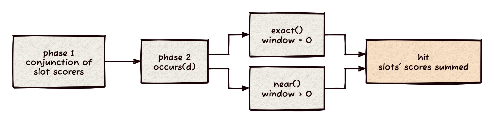

> Status: CURRENT (2026-10-30) `multi_phrase_scorer` at prospect main `b348da5` (landed in `14dbbbb`; ledger `docs/status/phrase-alternatives.md`). Source chapter for the Architecture and Design book, section 8.5.

# PHRASE and NEAR over alternatives

A phrase of plain terms is `phrase_scorer`. A phrase whose positions each hold alternatives (a wildcard or edit-distance expansion, an OR or SYNONYM of terms) is `multi_phrase_scorer` (`include/prospect/operators.hh:399`). It answers "do these slots occur at their relative positions, each met by any of its terms", and it scores a hit as the slots score alone.

## How it works

- **Slots.** A `phrase_slot` (`operators.hh:389`) is the scorer that finds and weighs the documents holding any alternative, plus the alternatives' `term_info`s, whose positions fill the slot. The constructor rejects an empty phrase, a slot without a scorer, and `offsets` of the wrong length (`operators.hh:403-404`).
- **Phase one.** A `conjunction_scorer` over the slots' scorers (`operators.hh:416`) yields the documents every slot holds. The scorer is two-phase: `approx_next` and `approx_advance` return that stream, `matches()` runs `occurs` once per document and caches the answer (`operators.hh:421-431`, `checked_` and `matched_`).
- **Phase two.** `occurs(d)` (`operators.hh:457`) advances each term's postings cursor to `d` and reads its positions, lazily (`begun`). A slot with more than one contributing term sorts and deduplicates the merged positions. An empty slot ends the check.
- **`exact()`** (`operators.hh:482`): offsets are taken relative to the first slot (consecutive by default; `offsets` leave gaps where words were removed). The slot with the fewest positions anchors the search; for each of its positions the start is derived and every other slot is binary-searched for `start + offset`. A position below its offset is skipped, so the start does not underflow.
- **`near()`** (`operators.hh:500`), with `window > 0`: one distinct position per slot, in any order, spanning fewer than `window` positions. The slots' positions are united, sorted and deduplicated. For each start, the positions less than `window` after it form a candidate window; it needs at least as many positions as slots. Distinctness is a bipartite matching of slots to window positions, found by augmenting paths (`assign`, `operators.hh:522`).
- **Score.** `score()`, `max_score`, `block_end`, `max_score_total` and `score_terms` forward to the conjunction (`operators.hh:432-438`), so a document scores the sum of its slots' scores in the order given, each as it scores alone, and the bound is the sum of the slots' bounds.

## Why this mechanism

- A slot's scorer already knows how an OR, a SYNONYM or an expansion scores. Reusing it makes the phrase score what the query's parts score, and it needs no phrase weighting of its own.
- The conjunction is cheap and prunes first: positions are read only for documents every slot holds.
- NEAR needs distinct positions per slot, which is a matching, not a scan: two slots can share a candidate position, and each position can serve one slot.
- A phrase of plain terms keeps `phrase_scorer`, which has its own bounds and positions path (`docs/mechanisms/query-operators.md`, "PHRASE and NEAR over alternatives").

## Invariants

- A document matches only if it is in every slot's scorer and the positions line up; the approximate stream never claims a phrase.
- A position shared by two alternatives of one slot counts once.
- The scorer does not override `fresh()` or `set_min_competitive_score` (defaults: `nullptr` and a no-op, `search.hh:142,150`), so it takes no copy and no minimum competitive score; a parent's pruning rests on the summed bound.
- Slots in one phrase must come from one field: Xapiand's builder returns no scorer when a phrase mixes fields, because positions are per field and document (`Xapiand/src/engine/strata/search.cc:361-377`).

## Proof

`test/multi_phrase_test.cc` compares the scorer with a brute-force model: fixed cases and 600 random phrases (`multi_phrase_test.cc:313`; alternatives of one to three terms, OR and SYNONYM slots, offsets with gaps, windows), checking the documents, each score, `next`, `advance`, two-phase iteration, top-k counted and pruned, and under a conjunction. The ledger records seven mutants, each killed (offset off by one, NEAR window `<=`, NEAR positions not distinct, score halved, every candidate accepted, a slot's terms not merged, only the first term's positions read), and a clean ASan+UBSan run. No timing: this note makes functional claims only.

## Code

`include/prospect/operators.hh:389-542`. The host builds it for a PHRASE or NEAR node with alternatives (`Xapiand/src/engine/strata/search.cc:400`): a NEAR without a parameter takes the slot count as its window.
